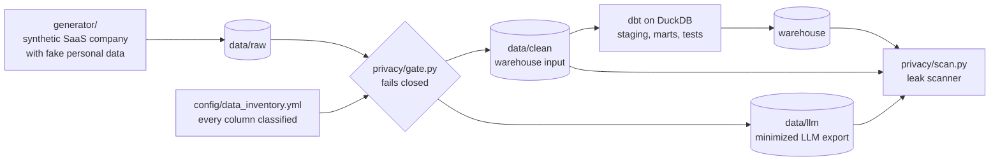

# AI-Ready RevOps

Revenue analytics for a B2B SaaS company, with a privacy gate in front of the warehouse and the LLM export.

Most revenue teams want analytics and AI on their CRM data, and most of those projects stall on the same question: which customer data is allowed to go into which tool. Here that question is answered by a column-level data inventory that a gate enforces before anything downstream runs, and tests check that it holds.



## Quickstart

```bash
pip install -r requirements.txt
make all DEV=1
```

`make all` generates the data, runs the gate, builds and tests the dbt project, scans the outputs for leaks and runs the pytest suite. Takes about 30 seconds on a laptop.

The gate won't run without `PRIVACY_KEY` set. `DEV=1` uses a random throwaway key instead. CI runs the same targets on every push, using the `PRIVACY_KEY` repo secret if there is one and a random key if not.

## 1. The data: a synthetic SaaS company

`generator/generate.py` simulates three years (Nov 2023 to Oct 2026) of a company selling to SMB, mid-market and enterprise buyers. The assumptions (win rates, deal sizes, cycle lengths, churn and expansion by segment) are in one parameter block at the top of the file.

Seed 42 gives 3,063 accounts, 7,515 contacts, 3,415 opportunities (16,500 stage-history rows), 7,065 marketing touches, 1,134 subscription events and 36 months of S&M spend.

Ordering is consistent (no deal before its account, no touch before its contact, one new-business sale per account, renewals close before the renewal month), but the data is deliberately dirty:

| Mess (seed 42) | Share | How the pipeline handles it |
|---|---|---|
| Duplicate account records (same company, different spelling) | 2.1% of accounts | Mapped to one canonical account by domain |
| Closed deals with no close date | 3.0% of deals | Imputed from the date the deal entered Closed Won or Lost, and flagged |
| Deals with no amount | 1.4% of deals | Kept as null and flagged; excluded from averages and counted separately, never treated as zero |
| Deals that skip a stage | 2.4% of deals | Counted as having passed through the skipped stage in the funnel |
| Free-text notes containing a name, email or phone number | 49% of deals | Dropped at the gate |

All personal data is fake: emails use the reserved `.example` TLD and phone numbers use the 555-0100 to 555-0199 range.

## 2. The privacy gate

`config/data_inventory.yml` classifies every column of every table. A class sets the handling and the maximum set of destinations; each column picks its destinations within that.

| Class | Handling | May go to | Examples |
|---|---|---|---|
| direct_identifier | dropped | nowhere | contact and rep names, emails, phones |
| free_text | dropped | nowhere | deal notes |
| pseudonymous_key | keyed hash (HMAC-SHA256) | warehouse, LLM | contact IDs, rep IDs |
| quasi_identifier | generalized | warehouse, LLM | job title to seniority band, hire date to month |
| confidential_business | kept | warehouse only | account names and domains |
| business_key, business_attribute | kept | warehouse, LLM | deal amounts, stages, dates |

The LLM export is narrower than the warehouse: deals, account attributes and subscriptions only. No contact rows, no rep table, and reps show up only as tokens. Keyed hashes are still personal data under GDPR, so I call that export minimized, not anonymized.

`privacy/gate.py` is the only path from `data/raw` to anything downstream.

- It fails closed. Unclassified tables or columns, unknown classes/handlings/rules/destinations, a column asking for more than its class allows, a row with the wrong field count, a missing key or a token collision all stop the run. Outputs are built in temp dirs next to their final location and swapped in only after the whole run succeeds; on an error the previous output is restored, so a failed run does not leave a half-written result.
- Pseudonymization is HMAC-SHA256 under `PRIVACY_KEY`, namespaced per key type. Same contact, same token in every table, so joins work, but without the key the tokens can't be reversed even though the source IDs are sequential.
- It writes `_manifest.json` with what was dropped/hashed/generalized, the inventory hash, key mode and a sha256 per output file.

`privacy/scan.py` doesn't trust the gate. It builds a deny-list from the raw data (names plus common variants like "last, first", "first.last" and "F. Last", emails and their local parts, phones, notes, original contact and rep IDs), normalizes case and whitespace, and searches every file under the gate output plus every table in the DuckDB file. It also runs email/phone regexes. A hardcoded set of protected columns applies regardless of the inventory, so loosening the YAML doesn't also loosen the scan. For `data/llm` it additionally flags account names, domains and any column not allowed there. Files it can't read are reported, not skipped.

`tests/test_privacy.py` (20 tests) covers the above, including regression tests for: a misspelled handling value, adding `llm` to a confidential column, rows with too few or too many fields, a rename failing partway through the swap, name variants planted in the output, PII inside a file type the scanner didn't originally read, and the dev key being random per run.

## 3. The metrics layer: dbt on DuckDB

dbt only reads `data/clean`. Staging casts types, dedupes accounts and imputes missing close dates. The marts:

| Model | What it answers | Definition |
|---|---|---|
| `arr_rollforward` | How did ARR move each month? | starting + new + expansion + contraction + churn = ending |
| `account_arr_monthly` | What was each account worth each month? | cumulative subscription events per account |
| `retention_monthly` | Do customers grow or shrink? | trailing-12-month NRR and GRR, by segment; GRR caps expansion |
| `pipeline_velocity_quarterly` | How fast does pipeline turn into revenue? | open qualified deals at quarter start x qualified win rate x average won ARR / average won cycle days, from Q2 2024 |
| `stage_funnel` | Where do deals die? | share of closed new-business deals reaching each stage |
| `rep_performance_yearly` | Who hits plan? | win rate and won ARR against annual quota; partial years and won deals with no amount are flagged |
| `cohort_logo_retention` | Do newer cohorts stick better? | share of each start-quarter cohort still paying N months later, with a flag for fully observed cells |
| `cac_payback_quarterly` | Is acquisition efficient? | prior-quarter sales and marketing spend / new logos, over new-logo gross margin |

Quarterly marts only report complete quarters (a one-month edge quarter makes CAC look 4x worse). Retention starts at Nov 2024, the first month whose 12-month base is inside the window; earlier bases haven't had time to churn and would overstate it. Velocity starts at Q2 2024 for the same reason.

### Data tests

Beyond the usual unique / not_null / accepted_values / relationships, singular tests in `dbt/tests/` fail the build if:

- the ARR bridge doesn't reconcile to the cent in any month
- company ARR from monthly event totals and the sum of account-level ARR differ by more than $1 in any month
- a won new-business deal closed before the as-of month doesn't book exactly one `new` event, or a `new` event has no deal
- a `new` event lands on an account that was already paying the prior month (that's expansion)
- any funnel stage disagrees with a count taken straight from stage history
- NRR/GRR disagree with a recomputation using `lag(arr, 12)`, or the retention base disagrees with a direct count
- a velocity quarter is missing a segment instead of showing zero
- account ARR goes negative, or a churn leaves a subscription above zero
- a closed deal has no close date after imputation, or closes before it was created

`dbt build` runs 15 models and 30 tests. I sanity-checked the cross-checks by deliberately breaking the models (e.g. counting lost deals at their first stage, dropping the GRR cap) and confirming the build fails.

## Results on seed 42

| Measure | Value |
|---|---|
| ARR, Nov 2023 to Oct 2026 | 13.0M to 24.7M |
| NRR / GRR, trailing 12 months to Oct 2026 | 92.2% / 90.9% |
| NRR by segment: enterprise / mid-market / SMB | 100.6% / 88.8% / 82.3% |
| New-business win rate, all closed deals: SMB / mid-market / enterprise | 29.5% / 20.9% / 17.2% |
| Funnel, Discovery to Closed Won | 26.1% |
| CAC payback, complete quarters from Q2 2024 | 5 to 25 months |

These are simulated numbers, not a real company.

## Known limitations

- Renewal outcomes are decided when the renewal opp is created, so the renewal stage path carries no signal. No renewal forecasting until that changes.
- Churned customers never come back as new business, and the pre-2023 installed base has no history.
- S&M spend is one company-level monthly number, so CAC is blended, not by channel or segment.
- Quota is flat per rep per year with no new-hire ramp. Partial years are flagged; don't compare them to full years.
- Retention is account-level, so growth on one subscription can mask shrinkage on another in the same account.
- The scanner ignores deny-list values under 6 characters, so a short first name on its own ("Eli") won't match. Full names and variants, emails, local parts, phones and IDs always do.

## TODO

- Bookings forecast (stage-weighted vs regression vs time series), backtested month by month
- Attribution: first/last touch, linear, position-based, compared against a Markov chain model
- Weekly pipeline-review agent that only reads `data/llm` and drafts a brief for human sign-off

## Layout

```
generator/   synthetic data generator
config/      data inventory and handling policy
privacy/     gate and leak scanner
dbt/         staging and mart models, data tests, macros
tests/       privacy test suite
data/        generated at run time, never committed
```

© 2026 Joseph Alise. All rights reserved.
